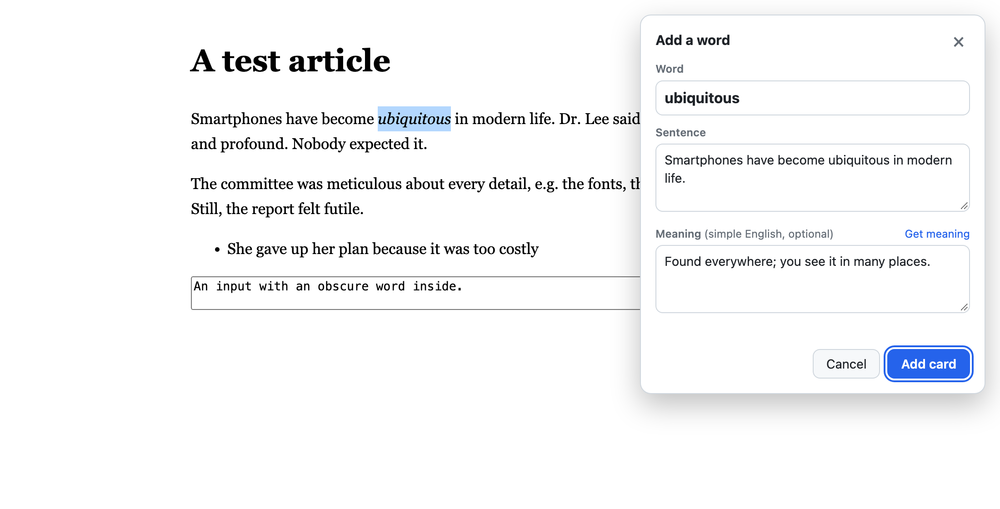
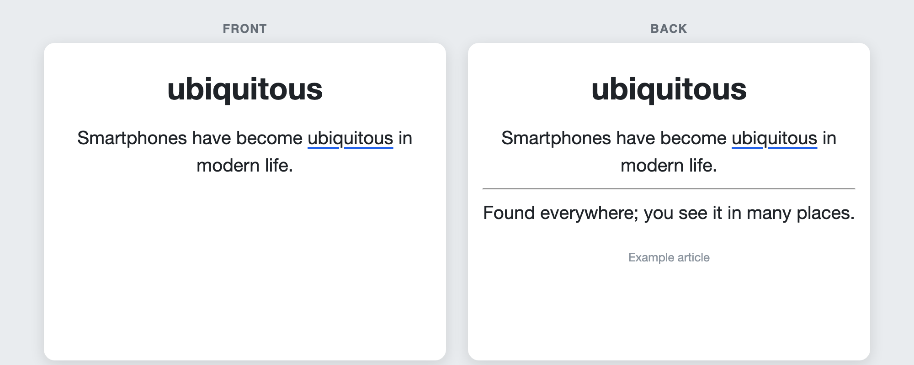
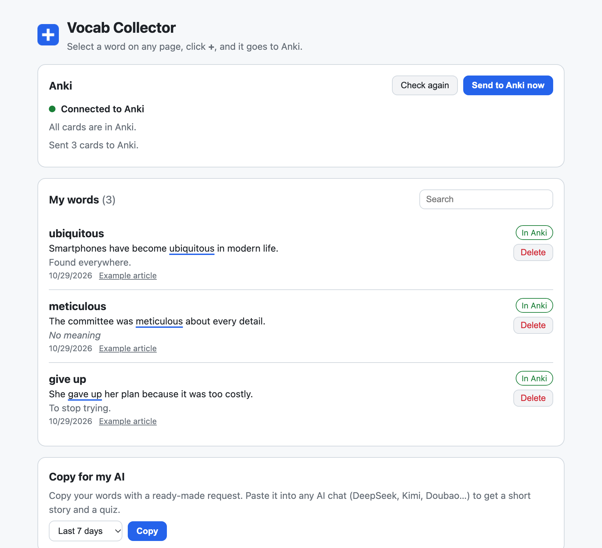

# Vocab Collector · 生词收集器

**读英文时，一键收集生词和它所在的句子，交给 Anki 帮你记住。**

[English](README.md) | 简体中文



---

## 为什么做这个工具

用外语阅读时，我们常常是这样的：遇到生词 → 查一下 → 看懂了 → 一周后忘了。

单独背一张单词表效果也不好，因为孤零零的单词很难记住。真正让一个词有意义的，是**你遇到它的那句话**。

Vocab Collector 是一个给英语学习者用的浏览器插件。它把"收集生词"变成**点一下**就能完成的事，同时保留真实的原句，并自动送进 **Anki**。Anki 会按照间隔重复（记忆曲线）的方法，在你快要忘记的时候提醒你复习。

## 怎么用

1. 在任意网页上**选中生词**（双击就行）
2. **点旁边出现的蓝色 +**，插件会自动找出这个词所在的句子
3. **确认后添加**，卡片直接进入 Anki，随时可以复习

可选功能：填上 AI Key 后，每张卡片背面会自动生成一段**简单的英文解释**。解释针对的是**这个词在这句话里的意思**，而不是词典里一长串的义项。

## 功能

- **一键收集**：点 **+** 按钮，按快捷键（`Alt+Shift+S` / `⌥⇧S`），或者用右键菜单
- **自动识别句子**：能正确处理 "Dr."、"e.g."、"3.5" 这类写法，不会把句子切错。识别结果也可以手动修改
- **也可以先选整句**：选中整句后按快捷键，再在弹窗里点击生词
- **简单英文解释（可选）**：支持 DeepSeek、Kimi、通义千问，以及任何兼容 OpenAI 接口的服务。不填 Key 时，卡片背面为空，也可以自己写解释
- **自动送进 Anki**：通过 AnkiConnect 自动创建牌组和卡片样式
- **不会丢词**：Anki 没打开时，卡片先保存在插件里，等 Anki 打开后自动补发
- **重复提醒**：添加以前收集过的词时，会显示之前的句子，由你决定还要不要再加
- **Copy for my AI**：一键复制本周的生词和一段写好的提示词，粘贴到任意 AI 聊天里，就能得到一篇用上所有生词的小故事和一份小测验
- **备份与恢复**：可导出为 JSON 文件，也可以从文件导入
- **支持浅色和深色模式**：可以在 **Mac 和 Windows** 上的 Chrome、Edge 及其他 Chromium 内核浏览器中使用

## 卡片样式

**正面**是粗体的单词和原句，句子里的生词带下划线。**背面**是简单英文解释和来源网页链接。



卡片可以在 Anki 电脑版或手机上复习（安卓用 AnkiDroid，iPhone 用 AnkiMobile）。建议在牌组选项里打开 **FSRS**，复习时间安排会更合理。

## 我的生词页面

点击工具栏上的插件图标，就能打开这个页面：查看所有生词、检查 Anki 的连接状态、把生词复制给 AI、修改设置。



## 安装

需要准备：**Chrome 或 Edge 浏览器**、**[Anki](https://apps.ankiweb.net) 电脑版**、**AnkiConnect** 插件（代码 `2055492159`）。

1. 下载本仓库（**Code → Download ZIP**）并解压。把 `extension` 文件夹放在一个固定的位置，之后不要移动它
2. 打开 `chrome://extensions`（Edge 浏览器是 `edge://extensions`），开启**开发者模式**，点**加载已解压的扩展程序**，选择 `extension` 文件夹
3. 在 Anki 里打开 **工具 → 插件 → 获取插件**，输入 `2055492159`，安装后重启 Anki
4. 点击浏览器工具栏上的插件图标，看到 **Connected to Anki** 就说明设置好了
5. （可选）在 **Settings** 里选择 AI 服务，粘贴 API Key，然后点 **Test AI** 测试

更详细的图文步骤请看 **[安装说明.md](安装说明.md)**。

## 隐私

- 生词**只保存在你的浏览器**和**你自己的 Anki** 里。没有服务器，也不需要注册账号
- 填了 AI Key 时，只会把**单词和所在句子**发给你选择的 AI 服务，用来生成解释。Key 只保存在你的浏览器里
- AnkiConnect 运行在你自己的电脑上（`127.0.0.1`）

## 路线图

Vocab Collector 先以浏览器插件的形式起步，最终目标是做成 **Mac 和 Windows 都能用的桌面 App**。

- [x] **v0.1**：浏览器插件，收集生词并送进 Anki
- [ ] **v0.2**：一键为旧卡片补全解释；上架 Edge 插件商店
- [ ] **v1.0**：桌面 App。用全局快捷键在**任何软件**里收集生词（PDF 阅读器、电子书等），并直接在 App 里复习（FSRS 算法，三档打分：陌生 / 模糊 / 认识）

## 开发者说明

插件用纯 JavaScript 编写（Manifest V3），不需要编译，也没有第三方依赖。

```
extension/
  manifest.json
  background.js      # 后台：保存卡片、调用 AI、发送到 Anki
  content.js         # 网页里的 + 按钮和"Add a word"弹窗
  options.html/js    # 我的生词页面和设置页
  lib/sentence.js    # 识别单词和所在句子（不依赖 DOM，以后的 App 可以复用）
  lib/ai.js          # 调用兼容 OpenAI 接口的 AI 生成简单英文解释
  lib/anki.js        # AnkiConnect：卡片样式、牌组、添加卡片
  lib/store.js       # 卡片和设置的本地存储
tests/
  sentence.test.js   # 句子识别的单元测试
  harness.html       # 用模拟的 chrome API、AI 和 Anki，在普通网页里运行插件
```

在 macOS 上用系统自带的 JavaScript 引擎运行句子识别测试：

```bash
/System/Library/Frameworks/JavaScriptCore.framework/Versions/Current/Helpers/jsc extension/lib/sentence.js tests/sentence.test.js
```

不安装插件也可以预览界面：在仓库目录里启动一个本地服务器（比如 `python3 -m http.server`），然后在浏览器里打开 `tests/harness.html` 或 `tests/options-harness.html`。
